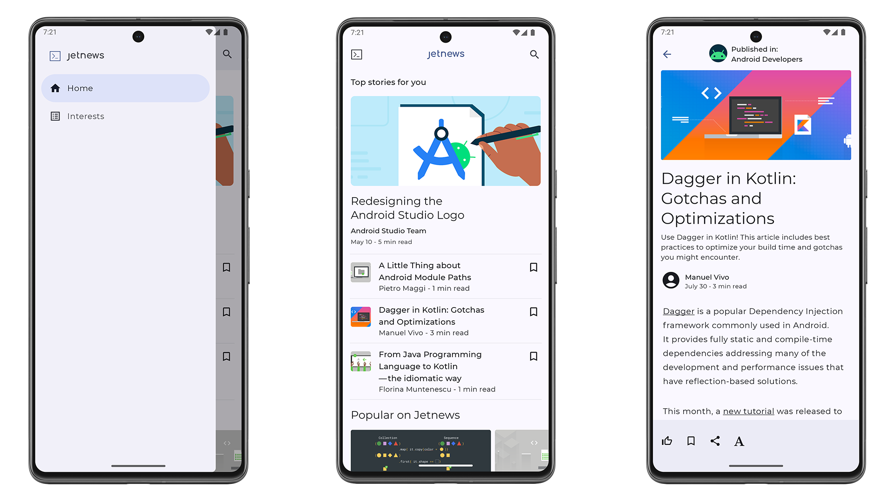

# Jetnews Sample

Jetnews is a sample news reading app, built with
[Jetpack Compose](https://developer.android.com/jetpack/compose). The goal of the sample is to
showcase the current UI capabilities of Compose.

## Build Instructions

First, install `gradlew` by running:

```shell
gradle wrapper
```

With `gradlew` installed, you can build the project by running:

```shell
./gradlew build
```

Run Android lint locally with:

```shell
./gradlew :app:lintDebug --no-daemon --stacktrace
```

The gradle wrapper and the gradle version it uses will automatically be updated to the correct
version during each build, if outdated. However, if the version of gradle used during the last build
is too old to start the current build (for example because you haven't built the project for a
while), you might get an error about your gradle version being too old. In this case, just re-run
the first command to get the correct version.

## GitHub releases

Run the **CD** workflow manually on `main` after CI succeeds for that exact commit.
CD rejects other branches, stale commits, and commits without a successful main-push CI run.
It reruns instrumented tests on an API 35 emulator and requires fresh screenshots.
Instrumented tests remain in CI as well.

Configure these existing repository signing inputs before releasing:

- `ANDROID_SIGNING_KEYSTORE_BASE64` (secret)
- `ANDROID_SIGNING_KEYSTORE_PASSWORD` (secret)
- `ANDROID_SIGNING_KEY_ALIAS` (secret or repository variable)
- `ANDROID_SIGNING_KEY_PASSWORD` (secret)

Publishing rejects missing or whitespace-only signing inputs and requires a nonempty keystore.
The preparation plugin passes `-PrequireReleaseSigning=true` to Gradle,
which disables the local/debug signing fallbacks for that build.
Ordinary local builds and instrumented tests retain their existing signing behavior.

CD uses `GITHUB_TOKEN` with `actions: read` and `contents: write`.
Repository rules must allow that identity to push the version commit and release tag.
Releases are serialized; they do not cancel a release already in progress.

`semantic-release` uses Conventional Commits on `main` to select the next version
(`fix` → patch, `feat` → minor, breaking changes → major; first release → `1.0.0`).
Both version analysis and release notes recognize breaking headers such as `feat!:` or `feat(api)!:`,
and `BREAKING CHANGE:` or `BREAKING-CHANGE:` footers.
If no release is warranted, it creates no version commit, tag, or release archives.
For a release, the preparation plugin updates `versionName` in `app/build.gradle.kts`,
increments `versionCode`, builds both variants, and verifies the signed AAB.
Only then does the git plugin commit those version changes with the exact message
`chore: bump version and build number`.
The `v<version>` tag points to that generated commit.
The CI gate applies to the input commit; CD builds its version-only derivative.

Each GitHub release includes `JetNews-<version>.zip` and `JetNews-<version>.tar.gz`,
with identical contents: the signed release AAB, debug APK, and three fresh instrumented-test screenshots
under `screenshots/`.
The same archives are retained as the `jetnews-release` workflow artifact.
No npm package is published, and the release tooling does not comment on issues or PRs.

If publication fails after the version commit or tag has been pushed,
inspect the existing tag/release and recover its assets from the workflow artifact.
Complete that release rather than deleting its tag or incrementing the build number again.
Commits pushed with `GITHUB_TOKEN` do not trigger CI automatically;
a repeated CD dispatch still needs a green CI run for its selected commit.

To verify release tooling locally without an Android SDK or GitHub writes,
use Node.js 22.22.2 or newer within Node 22, JDK 17, Bash, and tar:

```shell
npm ci --include=dev
npm test
npm run typecheck
```

Tests mock Android builds and GitHub API responses,
but exercise real JAR signing checks and extraction of both archive formats.
Do not run `npm run release` locally for validation; it can push and publish.

## Sample Contents



This sample contains three screens: a list of articles, a detail page for articles, and a page to
subscribe to topics of interest. The navigation from the the list of articles to the interests
screen uses a navigation drawer.

### App Scaffolding

Package [`com.example.jetnews.ui`][1]

[`JetnewsApp.kt`][2] arranges the different screens in the `NavDrawerLayout`. 

[`JetnewsNavGraph.kt`][3] configures the navigation routes and actions in the app. 

[1]: app/src/main/java/com/example/jetnews/ui
[2]: app/src/main/java/com/example/jetnews/ui/JetnewsApp.kt
[3]: app/src/main/java/com/example/jetnews/ui/JetnewsNavGraph.kt

### Main Article List

Package [`com.example.jetnews.ui.home`][4]

This screen shows how to create different custom Composable functions and combine them in a list
that scrolls vertically and horizontally.

See how to:

* Use `Row`s and `Column`s to arrange the contents of the UI
* Add a top app bar that elevates as the user scrolls
* Use Material's `Typography` and `ColorScheme` to style the text
* Use tonal elevation to make the `Card`s stand out from the background

[4]: app/src/main/java/com/example/jetnews/ui/home

### Article Detail

Package [`com.example.jetnews.ui.article`][5]

This screen dives into the Text API, showing how to use different fonts than the ones defined in
[`Typography`][6]. It also adds a bottom app bar, with custom actions.

[5]: app/src/main/java/com/example/jetnews/ui/article
[6]: app/src/main/java/com/example/jetnews/ui/theme/Type.kt

### Interests Screen

Package [`com.example.jetnews.ui.interests`][7]

This screens shows how to use Tabs and switch content depending on the selected tab. It
also includes a custom checkbox button, [SelectTopicButton][8]
that uses a `Toggleable` composable function to provide
the on/off behaviour and semantics, while drawing a custom UI. The UI of the button is partly
drawn with low-level primitives and partly overlaying images. See also how to visualize
on and off, light and dark version in the Android Studio Preview.

[7]: app/src/main/java/com/example/jetnews/ui/interests
[8]: app/src/main/java/com/example/jetnews/ui/interests/SelectTopicButton.kt

### AppWidget Powered by Glance

Package [`com.example.jetnews.glance`][9]

This package shows how to use Glance and write compose style code for AppWidgets.

See how to:
* Use `Row`, `Column`, `LazyColumn` to arrange the contents of the UI
* Use a repository from your existing app to load data for the widget and perform updates
* Configure `android:updatePeriodMillis` to periodically refresh the widget
* Use `androidx.glance:glance-material3` library to create a custom color scheme with `GlanceTheme`
and use dynamic colors when supported
* Tint `Image`s to match the color scheme
* Launch an activity on click using `actionStartActivity`

[9]: app/src/main/java/com/example/jetnews/glance

### Data

The data in the sample is static, held in the `com.example.jetnews.data` package.

### Instrumented and Robolectric Tests

UI tests can be run on device/emulators or on JVM with Robolectric.

* To run Instrumented tests use the "Instrumented tests" run configuration or run the `./gradlew connectedCheck` command.
* To run tests with Robolectric use the "Robolectric tests" run configuration or run the `./gradlew testDebug` command.
